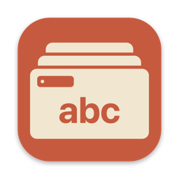

<div align="center">



# SpaceNamer

Give your macOS Spaces names, emoji and colors.

A small menu bar app that works with SIP enabled.


</div>

I built SpaceNamer for my own Mac to keep track of my Spaces, and I use it every day. I'm sharing it in case someone else finds it useful. It's a personal tool, so expect rough edges.

## Features

- The menu bar shows the current Space's name and emoji.
- A quick switcher lets you search for any Space, jump to it, or rename it from one panel.
- When you change Space, its name appears briefly in the middle of the screen.
- You can send the focused window to another Space from the menu bar.
- Each Space gets a soft gradient wallpaper. The color is assigned automatically, and you can change it.
- Names appear on the desktop of every display.

## Shortcuts

| Shortcut | Action |
| --- | --- |
| <kbd>⌃</kbd> <kbd>⌥</kbd> <kbd>Space</kbd> | Open the switcher |
| <kbd>⌃</kbd> <kbd>⌥</kbd> <kbd>R</kbd> | Rename the current Space |
| <kbd>⌃</kbd> <kbd>⌥</kbd> <kbd>E</kbd> | Choose an emoji and color for the current Space |

In the switcher: <kbd>↩</kbd> go · <kbd>⇥</kbd> rename · <kbd>⌘</kbd> <kbd>I</kbd> emoji and color · <kbd>⌘</kbd> <kbd>1</kbd>–<kbd>9</kbd> jump · <kbd>esc</kbd> close

## Build

```sh
./build.sh
open build/SpaceNamer.app
```

> [!NOTE]
> SpaceNamer is not signed or notarized, so macOS Gatekeeper blocks copies downloaded from the internet. Build it yourself with `./build.sh`, or right-click the app and choose **Open** the first time.

## How it works

macOS has no public API for Spaces. SpaceNamer reads them through read-only CoreGraphics calls and switches by pressing the Mission Control "Switch to Desktop N" shortcuts. It can turn those shortcuts on for you. Because it presses keys on your behalf, it needs Accessibility access.

## License

[MIT](LICENSE) © andguasta
